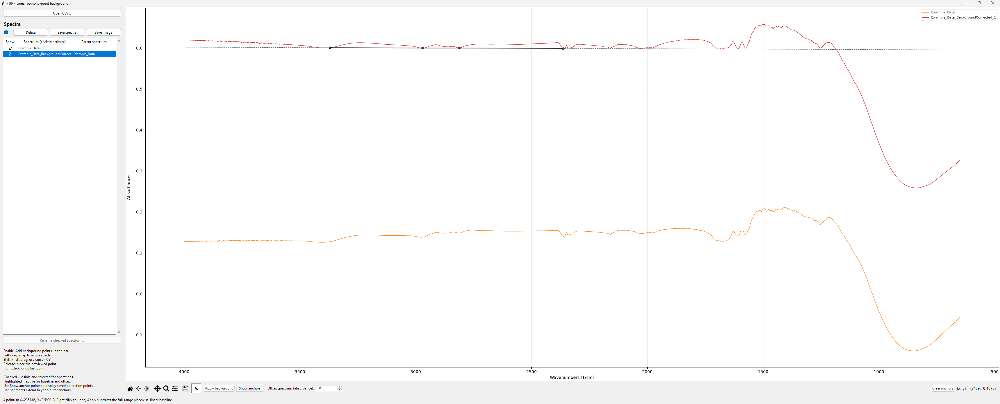

# Point-to-point linear FTIR baseline removal

This desktop application performs interactive linear point-to-point baseline
subtraction on FTIR spectra. It was designed to complement
[Spectragryph](https://www.effemm2.de/spectragryph/) and reads the CSV format
exported by Spectragryph.



## Features

- Open and display one or more spectra at the same time.
- Add baseline anchors snapped to the active spectrum or at free cursor
  coordinates.
- Interpolate a piecewise-linear baseline, extending the first and last
  segments beyond the outer anchors.
- Apply multiple corrections while preserving the correction history.
- Adjust the display offset between related spectra.
- Export corrected spectra with or without the cumulative display offset.
- Export a plot image for the selected spectra.

## Requirements

- Windows
- Python 3.10 or newer with Tcl/Tk support
- Dependencies listed in [`requirements.txt`](requirements.txt)

## Installation and launch

The included Windows scripts create a local virtual environment and install
the dependencies:

```bat
setup.bat
run_gui.bat
```

Alternatively, install the dependencies into an existing Python environment:

```powershell
python -m pip install -r requirements.txt
python ftir_gui.py
```

When no files are supplied, the application opens all CSV files in the
project directory. Files can also be supplied explicitly:

```powershell
python ftir_gui.py Example_Data.csv
```

## Input data

Input files must contain at least two numeric X,Y rows. The loader accepts
comma-, semicolon-, or tab-delimited files, optional leading header rows, and
additional columns after X and Y. X values must be unique and strictly
increasing or strictly decreasing. Spectragryph exports such as
[`Example_Data.csv`](Example_Data.csv) are supported.

## Workflow

1. Export a csv from Spectragryph
2. Open a CSV file with **Open CSV...**, or pass it on the command line.
3. Select the spectrum to correct in the spectrum list.
4. Use the pencil button in the Matplotlib toolbar; it is enabled by default.
5. Drag with the left mouse button to place points snapped to the spectrum.
   Hold **Shift** while dragging to place a point at the cursor's X and Y.
6. Add at least two points and click **Apply**. The corrected spectrum is
   inserted directly below its parent. Check **Retain baseline spectrum**
   before applying if you also want the calculated piecewise-linear baseline
   added as a separate, unchecked spectrum.
7. Use **Save spectra** to export selected spectra, choosing whether to
   include the cumulative display offset. Check the baseline spectrum first if
   you want to save or display it.

Use the **Move active up/down** buttons below the spectrum table to control
table order. This order controls plot layering and color assignment. The
toolbar also provides palette choices, including a colorblind-friendly
palette, and a line-weight control.

Right-clicking the plot removes the most recently added baseline point.
**Clear anchors** removes the current unfinished baseline and **Apply
baseline** creates a corrected spectrum. A highlighted spectrum is the
active spectrum used for baseline editing and offset changes; checked spectra
are visible and selected for operations. Enable **Show anchor points** to
display saved correction points for checked spectra.

**Offset spectrum (absorbance)** is a vertical offset in Y-axis units. Each
newly corrected spectrum defaults to the offset required to place its lowest
point at the same height as the highest point of its parent. Adjusting the
value changes only the spectrum's vertical display position.

## Round trip from OMNIC to Spectragryph and back again
See "OMNIC_Spectragryph_Data_Transfer_Guide" in this repository for a detailed set of instructions on how to process data in spectragryph and re-introduce the processed data to OMNIC. The .spa -> .spc -> .spa process will result in a file with incorrect metadata. Although the metadata can be injected into the binary through the OMNIC software, the new .spa file will retain the "blank" metadata as well as the user-created (true) metadata AND NOT ALL THE METADATA WILL SURVIVE. It is reccomended that you record the full metadata from OMNIC as soon as you finish collecting data so that you can always reference it without accessing the OMNIC software. 

## Tests

Run the test suite from the project directory:

```powershell
python -m unittest discover -s tests -v
```

## Project files

- [`ftir_gui.py`](ftir_gui.py): Tkinter and Matplotlib desktop interface.
- [`spectra_model.py`](spectra_model.py): spectrum loading, correction, and
  export logic.
- [`Example_Data.csv`](Example_Data.csv): example Spectragryph-style input.
- [`tests/`](tests/): model and GUI tests.
